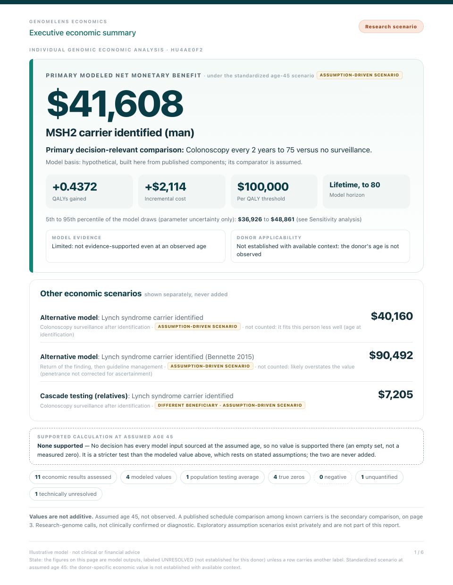
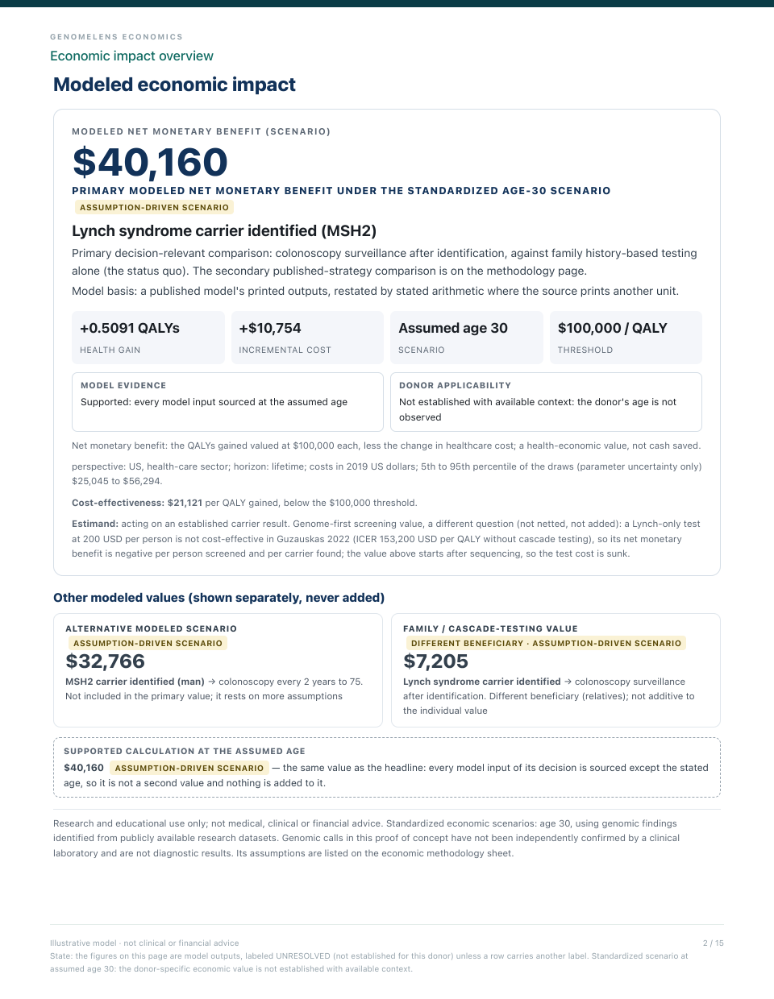
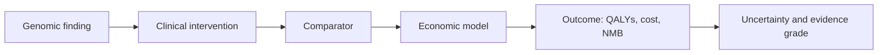

# GenomeLens

**Health economics for genomic decisions: what a finding is worth, against what comparator, and how well the evidence supports the number.**

**Who built it.** **Conall R. Aque**, an applied economist (M.S. candidate in Commerce and Economic Development, Financial Economics, Northeastern University, expected spring 2027), looking for a **full-time role in health economics, HEOR, real-world evidence or health technology assessment**. GenomeLens is my portfolio project. I conceived and directed it: I set its research and methodological requirements, evaluated its outputs, identified their limitations and oversaw the corrections. AI tools (Anthropic's Claude and OpenAI's ChatGPT) wrote the code and the documents under that direction ([details](#creator-role-and-ai-assisted-development)). Contact: [github.com/conallaque](https://github.com/conallaque)

**What it does.** It connects a genetic finding to the clinical decision it could change, values that decision against a named comparator the way a health-economics team would (quality-adjusted life-years, incremental cost-effectiveness ratios, net monetary benefit at a stated threshold), and labels every number as a published model's result, a hypothetical scenario, a measured null or a withheld figure.

**What it demonstrates.** Applied cost-effectiveness and cost-utility modeling; comparator and model selection; evidence synthesis and uncertainty; deterministic software testing; the line between economic modeling and clinical validation; and the refusal to monetize what the evidence cannot support.

**Featured HEOR demonstration:** [a six-page report on one genome: a hypothetical scenario at age 45, with its comparator, counterfactual, uncertainty and evidence evaluation](demonstrations/v1.11/featured/GenomeLens_public_six_page_HEOR_report_hu4AE0F2.pdf) (public edition; the model's inputs are not published).

**Inspect first (four reports):** [1. Lynch syndrome at age 30: a calculation derived from a published model](demonstrations/v1.11/GenomeLens_public_demonstration_hu4AE0F2_age30.pdf) · [2. the same carrier at age 45: an explicitly hypothetical scenario](demonstrations/v1.11/GenomeLens_public_demonstration_hu4AE0F2.pdf) · [3. CYP3A5 and tacrolimus: a qualified measured null](demonstrations/v1.11/GenomeLens_public_demonstration_huB4DBD7.pdf) · [4. NUDT15: an actionable finding whose monetization is withheld](demonstrations/v1.11/GenomeLens_public_demonstration_huDEFDD1.pdf). The [four demonstrations](#four-demonstrations) below explain each. Demonstration 1 also has a **HEOR technical dossier** (public edition: the cost-effectiveness plane, model cards, a CHEERS 2022 map and the validation record; the model's inputs are not published): [HEOR dossier, age 30](demonstrations/v1.11/dossiers/GenomeLens_public_HEOR_dossier_hu4AE0F2_age30.pdf).

**What supports the results.** Of 98 registered decision values (rows of the registry, not independent studies), 27 rest on 6 published analyses and 71 are hypothetical, assumption-based scenarios built here from published components or stated assumptions (60 of them first-pass pediatric models); a finding the evidence cannot support gets no dollar figure, never a zero · more than 11,000 automated tests in a private suite and 107 checks in a public verification suite (105 pass; 2 wait for a published table that is not shipped) · a 50-genome end-to-end run on public genomes · scripts, in Python and R, that recompute the arithmetic of one published table (the table is the publisher's and is not shipped).

**Limits.** No model has been externally validated; my oversight and the AI review passes are not independent validation. This is research software: not a clinical tool, not regulatory-cleared, not a claim of realized savings. The engine is private; the repository shows results, methods at a high level, and checks anyone can rerun. See the [limitations](docs/LIMITATIONS.md).

**Why this fits HEOR.** My training is in financial economics (discounting, decision under uncertainty, threshold reasoning); GenomeLens applies it to health decisions, and a separate public repository, [heor-model-replication](https://github.com/conallaque/heor-model-replication), rebuilds four published health-economic models from their printed parameters and reproduces the costs, effects, ICERs and dominance verdicts the papers report.

**Judgment behind the reports.** At age 45 neither candidate model of the colorectal-surveillance decision is clean, so the counted value is labeled a hypothetical scenario and not a supported estimate: the counted model's comparator (no surveillance) biases it upward, its death-only crediting pulls the other way, the published alternative is not counted because its penetrance is not corrected for ascertainment, and none of this is sized (the reports print the first and the third; the second is stated in [demonstration 2](#four-demonstrations) and the [limitations](docs/LIMITATIONS.md)). A cost-effectiveness result for one gene is not transferred to another (TPMT to NUDT15, demonstration 4).

**Start here (60 seconds):** [four demonstrations](#four-demonstrations) → [how a decision is modeled](docs/ECONOMICS.md) → [what it cannot tell you](docs/LIMITATIONS.md) → [how to read a report](docs/HOW_TO_READ_THE_REPORTS.md)

---

## Featured: a six-page HEOR report

[](demonstrations/v1.11/featured/GenomeLens_public_six_page_HEOR_report_hu4AE0F2.pdf)

**[Open the six-page report (PDF)](demonstrations/v1.11/featured/GenomeLens_public_six_page_HEOR_report_hu4AE0F2.pdf).** It is the compact form of what GenomeLens produces for one genome (demonstration 2 below: the MSH2 carrier at the standard stated age of 45), and it illustrates four things a health-economics reader looks for. **Economic decision analysis:** one decision, its named comparator and the value of acting, as net monetary benefit at $100,000 per QALY. **Counterfactuals:** the world with and without the genomic finding, and a comparator (no surveillance) that is an assumption and overstates the increment against average-risk screening. **Uncertainty:** a 5th to 95th percentile of the model draws, the choice between published models, and a second willingness-to-pay threshold. **Evidence evaluation:** every result in its evidence class, and what the value rests on and cannot claim. The primary value, $41,608, is a hypothetical, assumption-driven scenario built here from published components; it is not a published result, not an established economic benefit and not external validation. This is a public edition: a separate export prints a fixed list of fields, and it omits the model's inputs and structure, which are proprietary.

## Four demonstrations

Four demonstrations on three public research genomes (demonstrations 1 and 2 are the same genome at two stated ages), each chosen to show one thing the platform does. Every report is a public demonstration built through an allowlist export, and every value in it is a scenario at a stated age, not the donor's age and not a prediction.

**1. A published-model decision: Lynch syndrome carrier identified, at the age its source reports.** hu4AE0F2 (Harvard Personal Genome Project), stated age 30: net monetary benefit **$40,160** per carrier at $100,000 per QALY (+0.509 QALYs, +10,754 USD change in cost, 2019 US dollars; colonoscopy surveillance after identification against family history-based testing alone); **$21,121 per QALY gained**. **Class: published model, restated to a per-carrier value by stated arithmetic.** **What is the source's, what is GenomeLens's, and what is assumed.** *The source* (Guzauskas 2022) reports results per person screened in a population genomic screening program, four Lynch genes pooled: a cost per person screened at age 30 with cascade testing, a scenario without cascade testing (its ICER is about $153,200 per QALY), a 0.3% carrier prevalence and a $200 test. It reports no per-carrier value and nothing specific to MSH2. *GenomeLens's arithmetic* removes the $200 test as sunk, backs the quality-adjusted life-year gain out of the printed cost and ICER, divides both by the carrier prevalence and restates 2021 dollars as 2019 dollars ([the steps](docs/ECONOMICS.md#how-the-age-30-value-is-derived)). *The assumptions* are that the program's net effect other than the test accrues to carriers and that the four-gene average applies to an MSH2 carrier, whose risk is above that average, so the average probably understates it, by an unknown amount. The source did not report or validate an MSH2-specific individual result. It is the counted value because the stated age (30) is the age the source reports, and its comparator is the source's own status quo. The source itself finds that buying a Lynch-only test is not cost-effective in that scenario; the value shown applies once a carrier result already exists. Beside it, labeled a different question and in no total, is a published comparison of surveillance schedules among carriers who are already known; its arithmetic is recomputed outside the engine by scripts in Python and R ([`reproduction/`](reproduction/); the publisher's table is not shipped, so you supply it); one of its printed ratios does not reproduce from its own totals, and it is the one for the MSH2 comparison shown beside this value (29,299 printed, 32,438 recomputed; the figures shown use the totals). [Report](demonstrations/v1.11/GenomeLens_public_demonstration_hu4AE0F2_age30.pdf).

**2. A hypothetical, assumption-based scenario: the same carrier at the standard demonstration age.** hu4AE0F2 (Harvard Personal Genome Project), stated age 45: net monetary benefit **$41,608** per carrier identified at $100,000 per QALY (+0.437 QALYs, +2,114 USD change in cost, 2019 US dollars; colonoscopy every 2 years to 75 against no surveillance); **$4,835 per QALY gained**. **Class: hypothetical, assumption-based scenario.** The counted value comes from a model built here from published components and recomputed at 45; it is never presented as a published result. One published model gives a value at 45 for this decision (Bennette 2015, $90,492 once its printed figures are restated to 2019 dollars with one cost adjustment not published here, 2.2 times the counted value; the CDC model it adapts, Mvundura 2010, was later corrected downward by its authors, PMC4511954); the report shows it beside the counted value but does not count it. **Neither candidate is clean**, so the counted value is labeled hypothetical, a scenario and not a supported estimate. The judgment is set out in [the limitations](docs/LIMITATIONS.md#the-colorectal-surveillance-example-two-comparisons): the comparator's upward bias (printed in the report), the death-only crediting that pulls the other way, Bennette's penetrance, which is not corrected for ascertainment (printed), an assumed effect step (listed in the report's key assumptions), and none of them is sized. Demonstrations 1 and 2 are the same carrier at two stated ages, and their values are not comparable: they use different comparators and different models, so the difference is not an age effect (the model of demonstration 2 itself gives $32,766 at 30 and $41,608 at 45, against $40,160 for the published row at 30). Between 30 and 45 the model's discounted QALY gain rises (0.383 to 0.437) although its undiscounted life-years gained fall (1.389 to 1.152), because it discounts from the age of identification, and its net incremental cost falls (5,514 to 2,114 USD): fewer colonoscopies remain, and the cancers averted come sooner after identification and are discounted less. [Report](demonstrations/v1.11/GenomeLens_public_demonstration_hu4AE0F2.pdf).

**3. A correctly classified measured null: CYP3A5-guided tacrolimus dosing.** huB4DBD7 (Harvard Personal Genome Project), stated age 45. The report prints **$0 as a true zero** for this decision, labeled a measured null with its evidence: the trial's pharmacokinetic primary (target concentration at day 3) was not improved (37.4% vs 35.6%, p = 0.79) and rejection, an underpowered secondary endpoint, did not differ (p = 0.82); a meta-analysis found no clinical-endpoint difference (acute rejection RR 1.00, 95% CI 0.64 to 1.55) although it did find more patients in the target range at steady state (RR 1.40, 95% CI 1.14 to 1.72), so no health gain and no cost of acting is credited. CPIC (strong) advises a 1.5 to 2 times starting dose for expressers because they are less likely to reach target concentrations, a drug-level rationale. That is a result, not a missing value: the evidence was looked for and found no clinical-outcome difference. It is a measured null **on clinical outcomes, in kidney transplant recipients (the trial: low immunological risk, living donors)**; the interval is wide, so it is not proof of no effect, and the cost of acting is not measured (exposure is not sourced), so that term is set to zero rather than found to be zero. The report's footer counts a qualified personal medical value of $0 for this genome, measured nulls only, and says that findings not valued are not zero; they are listed separately. [Report](demonstrations/v1.11/GenomeLens_public_demonstration_huB4DBD7.pdf).

**4. A clinically meaningful finding whose monetization is withheld: NUDT15 Intermediate Metabolizer.** huDEFDD1 (Harvard Personal Genome Project), stated age 45. The finding is actionable (CPIC doses NUDT15 intermediate metabolizers with a reduced thiopurine starting dose), but no sourced economic evaluation applies to an adult carrier, so the report **withholds a dollar figure and prints the reason; the result is not zero**: the trial-based economic evidence for genotype-guided thiopurine dosing (TOPIC, PMID 26072396; its cost-effectiveness analysis, PMID 30698675) genotyped TPMT only, so its per-carrier value is not transferred to a NUDT15 carrier. The US economic evaluation that includes NUDT15 found in the literature for this report (Fuerte 2025, PMID 39470342) is a 16-week budget impact analysis of preemptive TPMT and NUDT15 testing in children with acute lymphoblastic leukemia, the two genes combined, and a UK cost-utility model (Roberts 2025, PMID 40548539) values testing per patient tested; neither gives an adult carrier's value. CPIC doses NUDT15 intermediate metabolizers with reduced starting doses, as it does TPMT. What would settle it: a cost-effectiveness analysis that includes this gene's carriers. [Report](demonstrations/v1.11/GenomeLens_public_demonstration_huDEFDD1.pdf).

## What a GenomeLens report looks like

[](demonstrations/v1.11/GenomeLens_public_demonstration_hu4AE0F2_age30.pdf)

*One page of a public demonstration report (hu4AE0F2 at the stated age of 30). The headline is a modeled net monetary benefit under a stated age, with the model basis and the strength of the evidence printed beside it. The age is a stated assumption, not the donor's; the value is a scenario, not a prediction. Badge key: "evidence-qualified" says every model input is sourced and the value does not rest on an age that is stated rather than observed; "assumption-driven" says an input, commonly the stated age, is an assumption; "limited" says the model would not be evidence-supported even at an observed age; "not established" says the donor's age is not observed. A badge describes provenance, not the strength of the clinical effect.*

## What the platform does

From one whole-genome callset, GenomeLens:

- reads the genome locally and identifies the findings that bear on a clinical decision;
- connects each finding to the decision it could change and to that decision's comparator;
- values the decision as quality-adjusted life-years (QALYs) gained, change in cost, cost per QALY gained and net monetary benefit at a stated threshold, perspective and horizon;
- classifies every result as a **published-model result**, a **hypothetical, assumption-based scenario**, a **measured null**, or **not monetized** with the reason;
- writes economic reports for different readers (the payer and genomics editions are private; the HEOR technical dossier has a public edition, for one demonstration), with every printed figure traceable to a stored result.

## Three application areas

**Individual health.** The finding, the intervention, the comparator, the model, the outcome and its uncertainty, for one person's genome.

**Family planning (two genomes).** Reproductive-risk findings across a pair: where both partners carry a finding in the same gene, the inheritance scenario that follows, and the economic parameters of the decision. Risk estimates, break-even reasoning and supported economic outcomes are kept as separate kinds of statement, and reproductive value is never added to an adult's own value. *Implemented; a public dual-genome demonstration report is not published yet.*

**Pediatric and rare disease.** Age, disease progression and intervention timing decide whether a benefit exists. GenomeLens values an intervention at the child's age and **withholds the modeled benefit when the window for the intervention has passed**, rather than carrying an at-birth value forward. *Demonstrated in synthetic age sweeps that are private; no public pediatric report is published yet.*

## From a genomic finding to an economic decision



Where a link is not supported, the report stops at that link and says which, or prints a figure only under an explicit hypothetical label. A model is chosen for the *decision*, by the validity of its evidence and its fit to the person, not by whether it is published: a published analysis of a different question is never the value; among models of the same question, one whose penetrance is corrected for ascertainment ranks above one whose penetrance is not, and the lower-ranked model is shown beside the counted value, not counted; where the counted model carries a bias of its own (a comparator that overstates the increment), the report prints it as an assumption; and where the best-ranked model is one built here from published components, its value is labeled hypothetical, a scenario and never a published result.

## Economic modeling capabilities

| Capability | What it provides |
|---|---|
| **Cost-effectiveness and cost-utility analysis** | Incremental QALYs and incremental cost against a stated comparator; the cost per QALY gained is printed beside each modeled headline value in the public reports, and dominance is reported as a status, not a ratio |
| **Net monetary benefit** | `NMB = λ·ΔQ − ΔC` at a stated willingness-to-pay threshold, never printed without it |
| **Perspective, horizon, discounting, price year** | Whose costs count, over what period, at what discount rate, in which year's dollars |
| **Age-dependent decision modeling** | Value as a function of the age at which a finding is made, and withdrawal of value past an intervention window |
| **Evidence tiers and provenance** | Each input labeled published, derived or assumption, with its source |
| **Uncertainty** | Parameter uncertainty only: draws from the ranges a source prints (rescaled to a per-carrier value where a source prints another unit), with the 5th to 95th percentile beside the value, labeled parameter uncertainty only; an input with no registered range is held at its point, an alternative model shown beside the counted value is not sampled and prints no interval, and a distribution is never invented |
| **Budget-impact reasoning** | A scale illustration per 1,000 members, labeled an illustration (private editions) |
| **Reporting standards** | Reports map their content to the CHEERS 2022 reporting items (shown in the public HEOR dossier; the other editions are private) |

Three questions are kept apart: whether a strategy lowers expected spending (**cost-saving**), whether the health it buys is worth its cost at a stated threshold (**cost-effective**), and whether a budget-holder can pay for it at scale (**affordable**). See [Economic methods](docs/ECONOMICS.md).

## Validation and reproducibility

These are software and engineering results from the final validation run of build `e89f545c`; none is evidence of clinical effectiveness. The complete table, with exact counts, is in [Validation](docs/VALIDATION.md#v111-release-candidate).

- **Automated tests:** 11,165 passed, 68 skipped, 1 failed (an environmental disk-space failure in a test that starts a pipeline from sequencing reads), full private suite on a clean snapshot of the final tree; see [`docs/VALIDATION.md`](docs/VALIDATION.md#v111-release-candidate).
- **End-to-end run:** the release candidate processed 50 public genomes; every economic document equals what its renderer makes from the saved results alone.
- **Traceability:** every printed figure traces to a stored result, in every format checked.
- **Layout and rendering:** 424 PDFs, 16888 pages rendered; 0 pages with defects.
- **Public export audit:** 16 public PDFs audited (15 at the standard stated age and 1 at the age its source reports); 0 findings.

Three kinds of checking are kept apart: *reproduction* (a model rebuilt from a source reproduces that source's printed outputs), *cross-check* (set beside a model by others) and *external validation* (compared with observed outcomes). **No model has been externally validated.** The arithmetic of one published table (a hereditary colorectal cancer surveillance analysis, 20 printed strategies) is recomputed outside the engine, by two separate scripts in Python and in R, from the source's printed totals (the scripts and the recorded output are here; the table is the publisher's and is not shipped, so you supply it as described in `reproduction/README.md`): which strategies are dominated, the efficiency frontier, each ratio, the optimal strategy at $100,000 per QALY and its net monetary benefit against two named comparators. All 20 classifications agree with the source and three of the four printed ratios reproduce; one does not, and the script says so. A fourth check finds that the source's printed QALYs are larger than the stated 3% discounting can give over its horizon, so its discounting convention is unresolved. That checks the arithmetic against the source, not the source: [`reproduction/`](reproduction/) (`python reproduction/reproduce_table2.py`, `Rscript reproduction/reproduce_table2.R`).

A public verification suite that reads only committed files ships here:

```bash
pytest tests/public
python tools/verify_public_release.py
```

What this repository lets you verify, and what it does not, is stated in [Validation](docs/VALIDATION.md#what-this-repository-lets-you-verify).

## All example reports

The four demonstrations above are part of this set. Each report is a public demonstration built through an allowlist export, never by redacting a production report, for a public research genome (Harvard Personal Genome Project participants who released their data, Genome in a Bottle, Illumina Platinum Genomes). The **Model basis** column says what stands behind the headline value; the value is a scenario at a stated age (30 for the published-model demonstration, the age its source reports; 45 for every other report), not the donor's.

| Genome | Source | Lead result | Modeled NMB (stated age, scenario) | Model basis | Evidence status | Report |
|---|---|---|---|---|---|---|
| hu4AE0F2 | Harvard Personal Genome Project | MSH2 carrier identified (man): colonoscopy every 2 years to 75 | $41,608 | Hypothetical, assumption-based scenario | Assumption-driven scenario | [PDF](demonstrations/v1.11/GenomeLens_public_demonstration_hu4AE0F2.pdf) |
| NA12878 | Illumina Platinum Genomes | CYP2C19 Intermediate Metabolizer: genotype-guided escalation | $39 | No basis label (a drug-response decision assembled from published inputs) | Assumption-driven scenario | [PDF](demonstrations/v1.11/GenomeLens_public_demonstration_NA12878.pdf) |
| HG006 | Genome in a Bottle | No modeled value leads this genome | n/a | n/a (no modeled value) | Not monetized | [PDF](demonstrations/v1.11/GenomeLens_public_demonstration_HG006.pdf) |
| HG003 | Genome in a Bottle | No modeled value leads this genome | n/a | n/a (no modeled value) | Not monetized | [PDF](demonstrations/v1.11/GenomeLens_public_demonstration_HG003.pdf) |
| huC8266A | Harvard Personal Genome Project | PMS2 carrier identified (man): colonoscopy every 3 years to 75 | $1,290 | Hypothetical, assumption-based scenario | Assumption-driven scenario | [PDF](demonstrations/v1.11/GenomeLens_public_demonstration_huC8266A.pdf) |
| hu2F1691 | Harvard Personal Genome Project | No headline value; the evidence finds no incremental benefit | $0 (a measured null) | Measured null: the evidence finds no incremental benefit | True zero, measured | [PDF](demonstrations/v1.11/GenomeLens_public_demonstration_hu2F1691.pdf) |
| hu694A23 | Harvard Personal Genome Project | No headline value; the evidence finds no incremental benefit | $0 (a measured null) | Measured null: the evidence finds no incremental benefit | True zero, measured | [PDF](demonstrations/v1.11/GenomeLens_public_demonstration_hu694A23.pdf) |
| hu833E7E | Harvard Personal Genome Project | No headline value; the evidence finds no incremental benefit | $0 (a measured null) | Measured null: the evidence finds no incremental benefit | True zero, measured | [PDF](demonstrations/v1.11/GenomeLens_public_demonstration_hu833E7E.pdf) |
| hu9A9B2D | Harvard Personal Genome Project | No modeled value leads this genome | n/a | n/a (no modeled value) | Not monetized | [PDF](demonstrations/v1.11/GenomeLens_public_demonstration_hu9A9B2D.pdf) |
| hu9AF7CC | Harvard Personal Genome Project | No modeled value leads this genome | n/a | n/a (no modeled value) | Not monetized | [PDF](demonstrations/v1.11/GenomeLens_public_demonstration_hu9AF7CC.pdf) |
| huB4DBD7 | Harvard Personal Genome Project | No headline value; the evidence finds no incremental benefit | $0 (a measured null) | Measured null: the evidence finds no incremental benefit | True zero, measured | [PDF](demonstrations/v1.11/GenomeLens_public_demonstration_huB4DBD7.pdf) |
| huCDD5EE | Harvard Personal Genome Project | No modeled value leads this genome | n/a | n/a (no modeled value) | Not monetized | [PDF](demonstrations/v1.11/GenomeLens_public_demonstration_huCDD5EE.pdf) |
| huDEDF57 | Harvard Personal Genome Project | No headline value; the evidence finds no incremental benefit | $0 (a measured null) | Measured null: the evidence finds no incremental benefit | True zero, measured | [PDF](demonstrations/v1.11/GenomeLens_public_demonstration_huDEDF57.pdf) |
| huDEFDD1 | Harvard Personal Genome Project | No modeled value leads this genome | n/a | n/a (no modeled value) | Not monetized | [PDF](demonstrations/v1.11/GenomeLens_public_demonstration_huDEFDD1.pdf) |
| huFE0257 | Harvard Personal Genome Project | No modeled value leads this genome | n/a | n/a (no modeled value) | Not monetized | [PDF](demonstrations/v1.11/GenomeLens_public_demonstration_huFE0257.pdf) |
| hu4AE0F2 (stated age 30) | Harvard Personal Genome Project | Lynch syndrome carrier identified: colonoscopy surveillance after identification | $40,160 | Published model | Assumption-driven scenario | [PDF](demonstrations/v1.11/GenomeLens_public_demonstration_hu4AE0F2_age30.pdf) |

**HEOR technical dossier (public edition).** For the published-model demonstration (the Lynch carrier at the age its source reports) there is an eight-page dossier in [`demonstrations/v1.11/dossiers/`](demonstrations/v1.11/dossiers/): every modeled value on one cost-effectiveness plane, an action-versus-inaction breakdown, a model card for each value (decision, comparator, population, perspective, horizon, discounting, price year, key assumptions and sources, and the basis where one is labeled), a CHEERS 2022 map that says which items are addressed, partly addressed or not reported, and the validation record. The model's inputs, structure and registry are not published, so CHEERS items that call for them are marked partly or not reported. A separate export prints a fixed list of fields; its check is that every decimal, and every whole number of 100 or more apart from years and axis marks, in the dossier also appears in that genome's public reports, the public documents or the reproduction kit's recorded output (the public suite re-runs this check), and the engine's own consistency checks are not extended to it.

**Reading one:** the headline is the net monetary benefit of one decision at a $100,000-per-QALY threshold; the badge beside it says how well the evidence supports it; the model-basis line says whether a published analysis stands behind it. [How to read a report](docs/HOW_TO_READ_THE_REPORTS.md) walks through the pages, classes and badges.

## Evidence governance: what GenomeLens will and will not monetize

GenomeLens does not monetize every finding. Each result lands in exactly one class, and values in different classes are never added.

| Published-model results | Hypothetical, assumption-based scenarios | Externally validated |
|:-:|:-:|:-:|
| 27 | 71 | 0 |

*Counts of registered decision values (rows of the registry, not independent studies: the 27 published rows rest on 6 published analyses; 60 of the 71 hypothetical rows are first-pass pediatric models). A value computed from a published model can still carry an "assumption-driven scenario" badge in a report: the badge reflects the stated age, which is an assumption for every public genome, and the model-basis line beside the headline says whether a published analysis stands behind it. The counted value is the best-ranked model of the decision for the person, ranked by the validity of its evidence and its fit to the person's age, not by whether it is published; a published value that is not counted (a different question, a different age or a known bias) is shown beside the counted one with the reason.*

| Class | Meaning | Example |
|---|---|---|
| **Published-model result** | The counted value is a published cost-effectiveness analysis's printed output, restated by stated arithmetic where the source prints another unit | A colorectal cancer surveillance decision at the source's own age |
| **Hypothetical, assumption-based scenario** | The best-ranked model is one built here from published components or stated assumptions; the value is labeled a scenario, never a supported estimate | The same decision at an age the source does not report |
| **Measured null** | The evidence finds no significant benefit, or care does not change at this genotype: zero by evidence, not by default (a measured null is not proof of no effect; its interval is printed where the source gives one) | A trial and a meta-analysis that find no significant outcome difference with genotype-guided dosing |
| **Not monetized** (printed as *unquantified* in the reports) | The evidence does not support a figure; the reason is printed, and the result is not zero | A finding actionable in principle without a published economic evaluation |

Missing evidence is never rendered as `$0`. A refusal is reported with its reason and is not a negative biological finding. **Limits that matter most:** no external validation; research-genome calls are not clinically confirmed; modeled values are conditional on the population, comparator, horizon and inputs of the model behind them; a published model's result is that source's result under its own population, comparator and assumptions (the colorectal comparison of surveillance schedules, for example, is among carriers who are already known and assumes perfect adherence, so it is shown beside the decision as a different question and is not the value of identifying a carrier). See [Limitations](docs/LIMITATIONS.md).

## Local processing and privacy

The platform is built to run on a local machine; its runtime does not send genomic data to a cloud service, and a local-only gate refuses any non-local model. The economic analysis is deterministic and does not depend on AI. An optional, locally hosted language model can assist plain-language interpretation; every run states whether it was used. This repository contains no personal genome, private health data or client material: every example is a public, open-consent research genome or a synthetic input.

## Questions I want to work on

Questions an HEOR or genomics team asks, which the platform is built to investigate: Does acting on a hereditary-cancer finding made at 25 rather than 45 change the cost per QALY gained? When does a pediatric intervention window close, so that its modeled benefit should be withdrawn? Which pharmacogenomic findings have no priced decision at all? How much of a headline value rests on published evidence and how much on assumptions? What would a payer's budget impact look like per 1,000 members? These are research directions in genomic screening, precision medicine, clinical decision support, payer economics and evidence generation; they are not claims of clinical validation, regulatory clearance, realized savings or commercial readiness.

**For evaluators.** GenomeLens is a demonstration of a method, not a distribution of it. What this repository can show: a published-versus-assumed classification on every result, reports on public genomes, the recorded output of a recomputation, outside the engine and in two languages, of one published table's arithmetic (the scripts are here; the table is the publisher's and is not shipped), and a documented list of limits. What it does not show, and does not claim: external validation, clinical validity, regulatory status, realized savings or commercial readiness. Start with [Limitations](docs/LIMITATIONS.md), then [Validation](docs/VALIDATION.md), then a demonstration report.

| Layer | Present in the software | Public evidence in this repository |
|---|---|---|
| Genome intake | Local callset reading; callability reported | Benchmark v1 summary; limitations |
| Decision modeling | Cost-utility analysis, NMB, age-dependent value | [Economic methods](docs/ECONOMICS.md); demonstration reports |
| Evidence governance | Model-basis classes; "not monetized" with the reason | Governance table above; reports |
| Three applications | Individual, dual-genome, pediatric | Individual demonstrations only |
| Audit | Figure-to-result tracing; layout and disclosure checks | Public verification suite |
| Audience outputs | Payer and genomics editions; the HEOR technical dossier | The payer and genomics editions are described only (private); the HEOR dossier is public in a reduced edition for one demonstration, and its full edition is private |

## About the author

I am seeking a full-time position in health economics, HEOR, real-world evidence or health technology assessment. Training in financial economics (discounting, decision under uncertainty, threshold reasoning) is what I apply to health decisions: M.S. candidate in Commerce and Economic Development (Financial Economics), Northeastern University, expected spring 2027. GenomeLens is my independent applied research project; it is where I practice defining the decision and its comparator, separating what the evidence supports from what it does not, and saying so in the report. The code, the automated checks and the documents were written by AI tools under my direction and review ([Creator role and AI-assisted development](#creator-role-and-ai-assisted-development)). I would like to bring this way of working (the decision, the comparator, the evidence grade) to a HEOR, RWE or HTA team, and I will walk through any model or report in an interview. Contact: [github.com/conallaque](https://github.com/conallaque)

**Rights and use.** Copyright 2026 Conall R. Aque. All rights reserved: no license is granted, other than the right of GitHub users to view and fork this repository under GitHub's Terms of Service. The models and the engine are not part of this repository. Published results quoted for recomputation (the colorectal surveillance table and the other sources cited) belong to their authors and publishers, and public genome data to its providers; see [Limitations](docs/LIMITATIONS.md#third-party-material).

---

<details>
<summary><strong>Reference record</strong>: development status, the frozen v1 benchmark, the earlier GIAB concordance record, public verification, creator role and repository boundary</summary>

## Development status

| | |
|---|---|
| Current development version | **v1.11**: private, under active development, not a public software release |
| Public benchmark evidence | GenomeLens Deterministic Benchmark v1, frozen: engine `4eaf729`, tooling `a9b3d3a` |
| This repository | Selected research methodology, historical benchmark evidence and sanitized public examples |
| Not distributed | The production implementation and its associated research assets |

The demonstrations and figures for the v1.11 release candidate are given above, with the build that produced them. The frozen v1 results below describe the v1 build only; they are not results for v1.11 and do not validate it.

## Research integrity

These principles govern how results are interpreted and reported.

- **A computable result is not necessarily a defensible result.** A number that can be calculated still needs an evidence chain from finding to outcome.
- **Clinical actionability and individual applicability are different questions.** A finding can be actionable in principle and not applicable to this person now.
- **Missing evidence is not zero benefit.** An absent input is reported as absent. It is never rendered as `$0`.
- **Perspectives and beneficiaries must be read correctly.** Quantities that answer different questions, for different beneficiaries, are not added together.
- **Unsupported aggregation does not produce totals.** A sum is reported only where its components are comparable.
- **Uncertainty and assumptions stay visible.** The result carries the evidence basis and the assumptions it rests on.
- **Declining to estimate can be a legitimate result.** A refusal is reported with its reason. It is not a negative biological finding.

The vocabulary used to report these states (supported, conditional, unresolved, refused, not economically applicable) is defined in [`docs/GLOSSARY.md`](docs/GLOSSARY.md).

---

## Public benchmark and technical evidence

### Deterministic Benchmark v1

A frozen, public-data technical proof of concept: 30 primary public genomes and 6 reference or parent genomes, 36 in total, run end to end as a deterministic control (no AI interpretation) on pinned engine and tooling builds. The results below describe that specific historical build.

| Measure | Result |
|---|---|
| Public genomes completed | 36 / 36 |
| Tests passed (private suite, frozen build) | 7,723 passed · 26 skipped · 0 failed |
| Release gates | 9 / 9 |
| Parity failures | 0 |
| Arithmetic discrepancies | 0 |
| Real-row assertions | 301 / 301 |
| Zero-audit defects | 0 / 1,399 |
| Forbidden-string hits across rendered PDFs | 0 / 144 |

*Parity* means every dollar and percentage printed in a report traces to a structured result, so a report cannot say something the analysis did not. The *zero audit* examines every displayed zero and requires it to be a supported null or no-change state, never a missing value rendered as zero. *Arithmetic* recomputes each net-monetary-benefit value from its recorded components wherever those components are separable. *Real-row assertions* are checked against rows the pipeline actually produced, not fixtures.

Full record: [Public Evidence Brief](benchmark/v1/GenomeLens_Deterministic_Benchmark_v1_Public_Evidence_Brief.pdf) (narrative, 6 pages) and [Public Results](benchmark/v1/GenomeLens_Deterministic_Benchmark_v1_Public_Results.pdf) (compact technical record, 4 pages). The [benchmark cover](benchmark/v1/GenomeLens_Deterministic_Benchmark_v1_Cover.png) is kept with them.

### What v1 establishes

- Reproducible execution across the intended public cohort, from pinned engine and tooling builds.
- Evidence and economic routing consistency, with no finding dropped from the economics without a recorded reason.
- Arithmetic integrity wherever economic terms are recomputable.
- Explicit missingness and zero semantics.
- Parity between structured results and rendered reports.
- Separate parent-pair reproductive economics.
- Resistance to unsupported external analyst suggestions entering the deterministic economic layer: 278 of 278 challenge items answered, none accepted into an authoritative result.

### What v1 does not establish

- Diagnostic sensitivity or specificity of whole-genome sequencing.
- Population prevalence or representativeness.
- Clinical efficacy for an individual patient.
- A universal cash value of a genome.
- Individualized medical or reproductive advice.
- Regulatory clearance or medical-device validation.
- Any property of versions after v1, including the current private development version.

### Disclosed limitations of the release

- **Visual review: ACCEPTED P2 VISUAL EXCEPTION.** 49 of 9,482 rendered pages were flagged, all in the full-genome `report.pdf`; the economics PDFs were clean. The flags were a bounding-box false positive and minor ancestry-label overlap and clipping. This is not an unconditional pass.
- Mutation harnesses were not rerun because their source anchors were stale.
- No separate full manual adversarial-review pass was completed across every final artifact; one Lynch report was read end to end.
- 20 economic rows are explicitly classified as not independently recomputable from separable ΔQALY / ΔCost source terms, rather than being filled with invented components.

### Reproducibility record

| | |
|---|---|
| Benchmark | GenomeLens Deterministic Benchmark v1 (frozen) |
| Engine | `4eaf729` |
| Tooling | `a9b3d3a` |
| Cohort | 30 primary public genomes + 6 reference/parent genomes |
| Data | Public, open-consent research genomes only. No personal genome, private genomic data or bloodwork. |
| Archive | Frozen benchmark artifacts were archived and integrity-checked locally. Internal benchmark packages and raw run outputs are not publicly distributed. |

The production implementation, reference data assets and economic parameterization are maintained privately. This repository publishes what GenomeLens evaluates, what it outputs, the evidence that it behaves as described, the principles that govern its output, and where its evidence stops.

---

## Earlier GIAB trio concordance (historical; superseded by Benchmark v1)

> **These are historical results from an earlier engine build**, kept for the record. They are not the current benchmark and are **not representative of v1.11 validation**: the figures below do not describe Deterministic Benchmark v1 or any later version, including the current private development version, v1.11. Use [Benchmark v1](benchmark/v1/) for current public results.

GenomeLens was run end to end on three publicly released [Genome in a Bottle](https://www.nist.gov/programs-projects/genome-bottle) whole-genome callsets, the Ashkenazim trio (HG002, HG003, HG004), using the publicly released GIAB GRCh38 benchmark callsets and defined confident regions. These are real public reference genomes with an external truth set. The per-genome economic reports of that build are no longer published in this repository's current tree (they remain in its Git history); only its technical-validation record is kept here.

| Sample | Explicit truth calls | Concordance |
|---|---|---|
| HG002 | [169](docs/VALIDATION.md#hg002) | **100.0%** (169/169, 0 mismatches) |
| HG003 | [187](docs/VALIDATION.md#hg003) | **100.0%** (187/187, 0 mismatches) |
| HG004 | [170](docs/VALIDATION.md#hg004) | **100.0%** (170/170, 0 mismatches) |

```
526 / 526  scoped explicit GIAB truth calls concordant
  0        mismatches
  0        normalization failures
```

Scope: GIAB **v4.2.1** · **GRCh38** · **chr1–22** · a fixed curated validation panel. This is agreement on the explicitly benchmarked calls inside that scope — not whole-genome accuracy, not clinical validation, and not an endorsement by NIST or GIAB. The three genomes are a father–mother–son trio, so the calls are not statistically independent. The denominator is published in [`docs/VALIDATION.md`](docs/VALIDATION.md#per-sample).

**What that is not.** Not 100% whole-genome accuracy. Not clinical validation. Not an endorsement by NIST or GIAB. It is agreement on the explicitly benchmarked calls inside the defined truth and callability scope: a denominator published rather than hidden.

The v1.11 release candidate's reports are in [`demonstrations/v1.11/`](demonstrations/v1.11/) (16 reports, including current demonstrations for HG003 and HG006). They are results of a later engine build and are not compared with the figures above.

---

## Public verification

[](https://github.com/conallaque/genomelens/actions/workflows/public-validation.yml)

GenomeLens is developed against a private automated regression suite covering genomic interpretation, evidence handling, health economics, uncertainty, reproducibility and reporting. The figure published for the frozen Deterministic Benchmark v1 build (engine `4eaf729`) is **7,723 passing · 26 skipped · 0 failed**. The earlier release-build status that accompanied the trio demonstrations is recorded in [`docs/TESTING.md`](docs/TESTING.md). For v1.11 the exact tally of the final build, with the one failure it records, is in [`docs/VALIDATION.md`](docs/VALIDATION.md#v111-release-candidate).

That suite stays private, because a test asserting what the engine does under a given input is a specification of the engine. A **representative public verification suite** ships here instead, written from the published artifacts outward rather than by exporting private tests. It is purpose-built around the public claims and lets what this repository publishes be inspected independently. **Public validation: 107 checks — 105 passed, 2 skipped (the two that need the published table, which is not shipped).**

```bash
pytest tests/public                     # 107 checks: 105 passed, 2 skipped
python tools/verify_public_release.py   # one-command release verification
```

Both read only files committed to this repository — no network, no credentials, no engine dependency, so a fresh clone can run them.

[Public validation suite](tests/public) · [Testing methodology](docs/TESTING.md)

## What a public report contains

Each run produces a genomic and health-economic report containing supported findings, carrier status, pharmacogenomics, callability and source state; evidence provenance per finding; reference-case and standardized pathway economics; incremental cost, incremental QALYs, ICER or dominance; probabilistic sensitivity analysis; and explicit refusals and limitations. Reports are published only through the allowlist export profile in [`PUBLIC-REPORT-SPEC.md`](docs/PUBLIC-REPORT-SPEC.md).

## Where GenomeLens stops

- It does not monetize a pharmacogenomic finding merely because a genotype is guideline-actionable when the medication or indication is unknown.
- It distinguishes an unsupported absence claim from a true negative.
- It does not claim production support for every copy-number, structural, repeat-expansion, CYP2D6 star-allele or mitochondrial-heteroplasmy problem.
- It does not read a GIAB benchmark as clinical validation. Concordance establishes agreement with the external truth calls within the benchmarked scope; it says nothing about clinical utility.
- It does not treat economic arms as additive by default.
- Where a benefit is estimable but its real-world cost is not adequately sourced, it can report a maximum model-consistent cost bound rather than silently treating the unknown cost as zero or inventing an actual market price.

---

## Research limitations

Research software. Not a diagnostic device. Not medical advice. Its economic outputs are model-dependent: they rest on assumed treatment effects, event costs, utility decrements, discount rate, time horizon and willingness-to-pay threshold, and where an assumption's plausible range changes the sign of a result, that is disclosed rather than resolved by choosing a convenient value. Technical reproducibility does not establish clinical effectiveness, payer approval or external health-economic validation; public benchmark agreement is not clinical validity; modeled results are not realized savings. Full statement: [`docs/LIMITATIONS.md`](docs/LIMITATIONS.md).

## Creator role and AI-assisted development

The project was independently conceived and directed by its author: the research direction, the health-economic methodology, and the validation strategy and its oversight.

The code and the documents were written by AI tools (Anthropic's Claude and OpenAI's ChatGPT) under the author's direction; AI tools also searched the literature and ran review passes. That includes the two research PDFs in [`research/`](research/), which carry signed Content Credentials recording that they were produced with an AI tool (OpenAI's ChatGPT). The author independently conceived and directed the project: set its research and methodological requirements, evaluated the outputs, identified their limitations and oversaw the corrections, which the AI tools implemented; neither the code nor the documents are presented as written by hand. The author's oversight is not independent scientific validation; what has been checked externally, and within what scope, is stated in [`docs/VALIDATION.md`](docs/VALIDATION.md). Details are in [`docs/PROJECT-SCOPE.md`](docs/PROJECT-SCOPE.md#creator-role).

## Public repository boundary

This repository contains selected methodology, validation evidence, curated reports and integration examples. The production engine, internal economic parameter registries, routing logic and qualification machinery are maintained separately. Public artifacts are generated through a deliberately constrained export layer so that validation evidence and interpretable results can be inspected without exposing the production engine.

---

## Repository guide

| | |
|---|---|
| [`research/`](research/) | Research and Methodology Overview and an illustrative HEOR case study (PDF) |
| [`benchmark/v1/`](benchmark/v1/) | Deterministic Benchmark v1: evidence brief, results record, cover |
| [`docs/`](docs/) | Architecture, economics, glossary, how to read a report, limitations, scope, report spec, release status, testing, validation |
| [`demonstrations/v1.11/`](demonstrations/v1.11/) | Public demonstration reports of the v1.11 release candidate (allowlist export) |
| [`tests/public/`](tests/public) · [`tools/verify_public_release.py`](tools/verify_public_release.py) | Public verification suite and one-command release check |
| [`partner/OVERVIEW.md`](partner/OVERVIEW.md) · [`examples/`](examples/) | Technical overview and public schema example |

</details>
